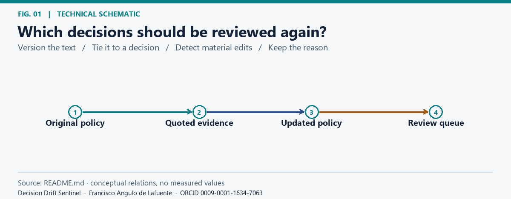
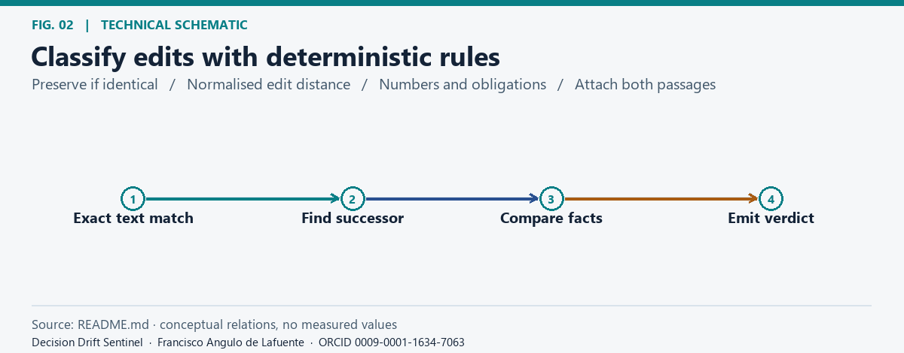
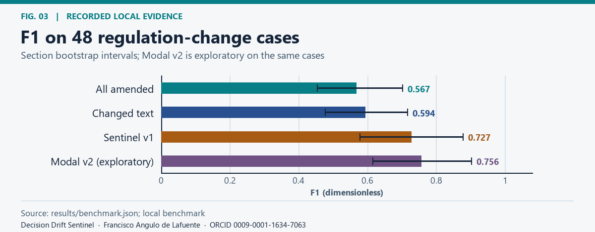
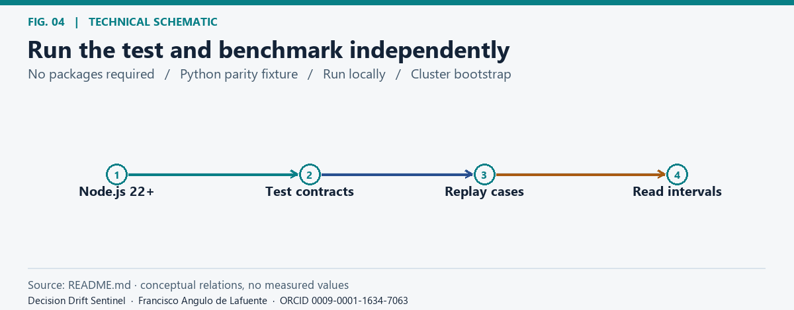
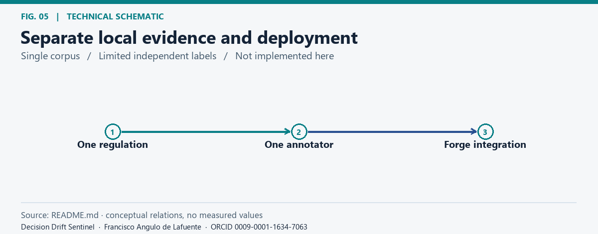
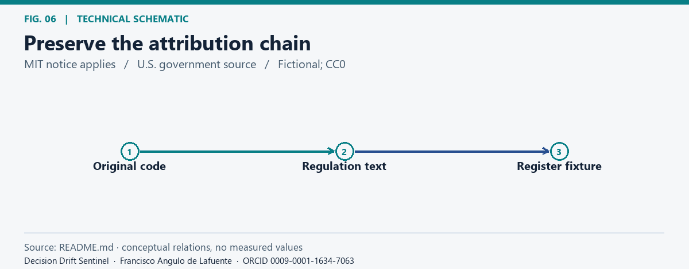
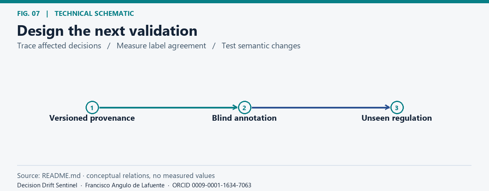

# Decision Drift Sentinel

**Original software author:** © 2026 Francisco Angulo de Lafuente · [ORCID](https://orcid.org/0009-0001-1634-7063) · Attribution record: 2026-11-06 · [CITATION.cff](CITATION.cff) · [Software metadata](codemeta.json).

<!-- impact-note:start -->
<strong>Efficiency and practical value.</strong> Deterministic quote and fact checks direct attention to policy changes that may affect earlier decisions, without calling a model or network service. In the documented 48-case fixture, Sentinel v1 achieved higher F1 than reviewing every changed quote, providing a concrete basis for more selective review effort. The scope remains that local fixture. See the <a href="#benchmark">comparison and limits</a>.
<!-- impact-note:end -->

## Research question

*Which decisions should be reviewed again?.* [Static figure](docs/figures/fig-01.png).

When a source policy changes, which decisions depending on it need another review? This is the deterministic research core prepared for [Atlassian Codegeist 2026](https://codegeist2026.devpost.com/rules). It keeps a traceable relationship between an assessment and the quoted evidence supporting it.

## Method

*Classify edits with deterministic rules.* [Static figure](docs/figures/fig-02.png).

Check whether the original quote remains verbatim. Otherwise, locate a candidate successor with normalised Levenshtein distance and compare explicit facts: amounts, percentages, durations, and obligation or permission cues. Output `UNCHANGED`, `EDITORIAL_ONLY`, `REVIEW_MATERIAL`, or `REVIEW_NOT_FOUND` with the relevant evidence. This is a rule-based tool; the core calls no model or network service.

## Benchmark

*F1 on 48 regulation-change cases.* [Static figure](docs/figures/fig-03.png).

The local fixture contains 48 documented assessments covering the October 2024 update to 2 CFR Part 200. One blinded annotator labelled 19 material changes. The preregistered Sentinel v1 sent 25 cases to review (precision 0.640, recall 0.842, F1 0.727, section-bootstrap F1 interval 0.58–0.88). Reviewing every case amended by the eCFR yielded F1 0.567; reviewing every changed quote yielded 0.594. Modal v2 yielded F1 0.756 on the same cases after exploratory error analysis; it is not an independent confirmation. See [benchmark output](results/benchmark.json) and [experiment log](experiments/LOG.md).

## Reproduce

*Run the test and benchmark independently.* [Static figure](docs/figures/fig-04.png).

Use Node.js 22 or later. There are no npm runtime dependencies.

~~~sh
npm test
npm run bench
~~~

The tests check the supplied benchmark fixture case by case. The optional fixture exporter documents the earlier Python reference; the npm commands run using the included fixture.

## Limitations and Forge status

*Separate local evidence and deployment.* [Static figure](docs/figures/fig-05.png).

The benchmark covers one regulation rewrite, with one annotator and correlated assessments. This supports a local research comparison, not a general legal conclusion or an automated compliance decision. Forge manifest, Jira and Confluence integrations, deployment and hackathon submission are not part of this release. Validate on an unseen regulation with multiple reviewers and measure agreement before extending the claim.

## License and citation

*Preserve the attribution chain.* [Static figure](docs/figures/fig-06.png).

Original software is under the [MIT License](LICENSE), with the rule lineage credited to the author's [Regulation Change Sentinel](https://github.com/Agnuxo1/zetaris-regulation-change-sentinel). The fixture identifies the eCFR source and includes a fictional register marked CC0. Preserve relevant rights and notices and cite [Francisco Angulo de Lafuente](https://orcid.org/0009-0001-1634-7063) using [CITATION.cff](CITATION.cff).

## Bibliography and research directions

*Design the next validation.* [Static figure](docs/figures/fig-07.png).

The following primary sources inform proposed checks. Their text, code, figures, and data are not included in this documentation update.

- [U.S. Office of the Federal Register, 2 CFR Part 200](https://www.ecfr.gov/current/title-2/subtitle-A/chapter-II/part-200). Record the exact regulation versions used by the fixture before adding another rewrite.
- [W3C (2013), PROV-O: The PROV Ontology](https://www.w3.org/TR/prov-o/). Link each decision to source entities and revision activities.
- [Parikh et al. (2016), A Decomposable Attention Model for Natural Language Inference](https://arxiv.org/abs/1606.01933). Evaluate an entailment comparator for wording-only shifts as a separate prospective baseline.

**Attribution and reuse.** This project contains open-source material under the MIT License. When redistributing copies or substantial portions, retain the copyright and permission notices. If you build on this work, please cite the project and credit Francisco Angulo de Lafuente (ORCID: 0009-0001-1634-7063). Help advance scientific knowledge: we welcome reproducible results, corrections, and contributions.

MIT applies only to the original software and documentation listed in [LICENSE_SCOPE.md](LICENSE_SCOPE.md). Upstream, regulatory, benchmark, and figure materials retain their separately documented terms. See [license](LICENSE), [figure methods and provenance](docs/figures/README.md), and the [research provenance record](provenance.json).

<!-- research-provenance: project=Decision Drift Sentinel; recorded_on=2026-11-06; author=Francisco Angulo de Lafuente; orcid=https://orcid.org/0009-0001-1634-7063; license_scope=LICENSE_SCOPE.md -->
