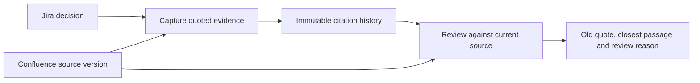

# Decision Drift Sentinel for Forge

**Local candidate, 10 November 2026. Cloud qualification is pending.** The backend
and two native UI Kit entry points compile against the pinned Forge SDKs. Twenty
local workflow/protocol checks and TypeScript pass. No Forge application has been
registered, deployed, installed for judges or submitted to Codegeist by this work.

## A decision with a traceable source

Open the issue panel on a Jira decision, load a Confluence page from the same site
and select its supporting paragraph. Capturing records the quote, source version
and document digest. Opening a saved citation compares the old quote to the current
page and displays both passages, changed tracked facts and the versions.

The Confluence macro identifies a source and its current version. New captures
retain earlier citations. Checks run when someone opens or refreshes a citation;
there is no background page-change subscription or automatic Jira status update.



This is assistance for **textual excerpts**. An unchanged quote does not establish
that the surrounding policy or the decision is still valid. The UI reports page
version changes separately and provides no legal or compliance approval.

## Research lineage and evidence

The original [deterministic core](../src/core/drift.js) is copied byte-for-byte;
[CORE_PROVENANCE.json](CORE_PROVENANCE.json) binds its SHA-256 to source commit
`7e58a7615555a727b1ab71e21a3875602498919b`. R01 retains its prepared `modal_v2`
rule, including can/will cues. This rule was selected through exploratory error
analysis on the historical cases; it is not an independently confirmed model.
No new F1 claim is made. The original nine tests passed unchanged before integration.
The earlier 48-case, single-annotator regulation benchmark and exploratory v2
remain documented in the parent project; this app work is not a new validation
cohort or a general semantic-change detector.

The 20 new local checks cover permission revocation, issue-bound storage access,
source-version and paragraph-digest races, independent concurrent captures,
idempotent retries, same-site URL validation, document bounds, literal untrusted
content, stale source versions and both current Forge Bridge response forms.
They exercise in-memory adapters and do **not** establish actual cloud integration.

## Run the local checks

Use Node22.23.4 or later supported by the chosen tooling. Install the exact lockfile:

```sh
npm ci
npm test
npm run typecheck
npm run build:check
```

`build:check` bundles the real SDK backend and both frontend modules locally.
The registry audit snapshot on10November2026 reported zero advisories after the
three exact transitive security patches documented in
[DEPENDENCIES.md](DEPENDENCIES.md). Direct Forge SDK versions remain pinned.

## Permissions and data handling

Jira access is checked as the invoking user before any citation storage access.
Capturing also requires edit permission for that specific issue; read access
alone does not authorize a citation write.
Confluence access is rechecked before returning saved source metadata or text.
App storage uses issue-bound keys within Forge's installation scope. Captures
use independent keys and atomic `FAIL_IF_EXISTS` writes. Concurrent retries keep
the first successful record and its timestamp; the winner's source fields are
validated before it is returned. The source
is fetched again and its version and selected-paragraph digest checked on capture.

Scopes are `read:jira-work`, `read:page:confluence` and `storage:app`. The app calls
Atlassian APIs and keeps its citation records in Forge storage. It has no external
LLM, external content export, user-content logging or Jira issue-write operation.
React renders source material as text. Page links must match the invoking Jira
site; identifiers address Confluence on that same installation.

Unsupported rich nodes, documents larger than128KiB, more than80paragraphs,
paragraphs above800characters or excessive nesting require manual review. The
app never silently truncates these inputs and declares them unchanged. Formatting,
links, images and the full policy context require human inspection beyond the
textual-quote comparator.

## Cloud qualification before an official entry

`manifest.yml` has an explicit all-zero **unregistered placeholder**. Local
compilation does not validate an application identity. The actual Forge15.1.0
`lint` command reached its login requirement and has not passed. A child-only
`FORGE_DISABLE_ANALYTICS` setting avoids the optional analytics prompt without
changing global preferences. No authentication secret is stored in this project.

After the owner supplies an authorized Atlassian development environment, register
the real application, run `forge lint`, install Confluence first and link Jira on
the same site, then validate source updates, access revocation and concurrent
captures in the real products. Record those results separately from the local
checks. Generate and test the judges' installation link and record a real working
demo under five minutes before submitting. Current requirements:
[Codegeist rules](https://codegeist2026.devpost.com/rules).

The original parent README and figures describe the earlier research release.
This directory adds the integration candidate and explicitly preserves that
release's code, data, metrics, attribution and limitations.

<!-- author-background:start -->
## Author background

**Francisco Angulo de Lafuente**, independent AI researcher · [ORCID](https://orcid.org/0009-0001-1634-7063) · [arXiv](https://arxiv.org/a/angulodelafuente_f_1.html) · [Google Scholar](https://scholar.google.com/citations?user=6nOpJ9IAAAAJ) · [ResearchGate](https://www.researchgate.net/profile/Francisco-Angulo-Lafuente-3) · [Figshare](https://figshare.com/authors/Francisco_Angulo_de_Lafuente/22601234) · [Wikipedia](https://es.wikipedia.org/wiki/Francisco_Angulo_de_Lafuente)

Earlier research at ECOFA focused on biotechnology for clean energy and on second-generation biofuels obtained by microbiological processing of organic waste. Two Spanish patents document that work:

- **ES 2273594 B1**, *Process for obtaining fuels from organic waste*. Filed 5 September 2005, grant published 16 February 2008. [OEPM](https://www.oepm.es/pdf/ES/0000/000/02/27/35/ES-2273594_B1.pdf) · [Google Patents](https://patents.google.com/patent/ES2273594B1/en)
- **ES 2341194 B1**, *Method for obtaining paraffin by a biological process with microorganisms from organic matter, and its refining for use as fuel*. Filed 11 September 2007, grant published 26 April 2011. Also published as EP2196519 and WO2009034217. [OEPM](https://www.oepm.es/pdf/ES/0000/000/02/34/11/ES-2341194_B1.pdf) · [Google Patents](https://patents.google.com/patent/ES2341194B1/en)

These are historical publication and grant records under the inventor name Francisco Angulo Lafuente, and both have since lapsed. They are cited as evidence of a research trajectory and make no statement about current enforceability.
<!-- author-background:end -->

## License

The directory's original software is MIT, with lineage retained in the copied
core. See [LICENSE](LICENSE) and [LICENSE_SCOPE.md](LICENSE_SCOPE.md). Installed
Forge SDKs and other packages retain their upstream licenses and notices.
